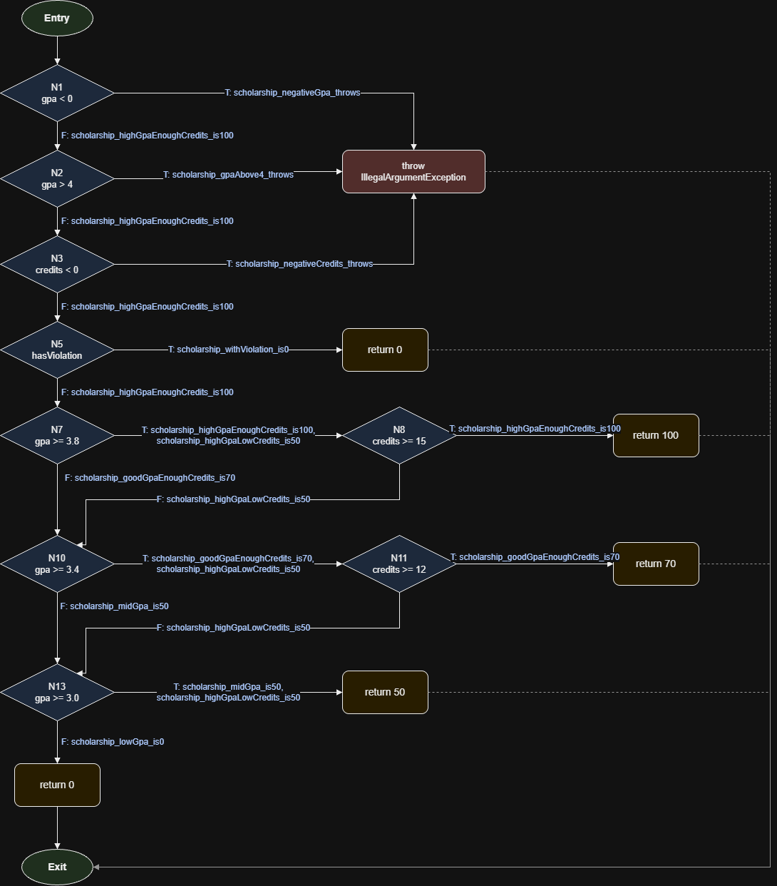

# Лаб 09 — Код хамралт: JaCoCo-гоор тестээ хөтлөх

**Нэр:** Х.Дэлгэр
**Оюутны код:** B222270835
**Хичээл:** F.CSA313 — Программ хангамжийн чанарын баталгаа ба тест

## Орчин

```
$ java -version
java version "24.0.2" 2025-07-15
Java(TM) SE Runtime Environment (build 24.0.2+12-54)
Java HotSpot(TM) 64-Bit Server VM (build 24.0.2+12-54, mixed mode, sharing)
```

```
$ mvn -version
Apache Maven 3.9.16 (2bdd9fddda4b155ebf8000e807eb73fd829a51d5)
Maven home: C:\tools\apache-maven-3.9.16
Java version: 24.0.2, vendor: Oracle Corporation, runtime: C:\Program Files\Java\jdk-24
Default locale: en_US, platform encoding: UTF-8
OS name: "windows 10", version: "10.0", arch: "amd64", family: "windows"
```

Windows 10 дээр MSYS2 (UCRT64) bash терминал ашигласан тул `tee` гаралтыг UTF-8-аар хадгалсан.

**pom.xml-д хийсэн өөрчлөлт:** starter-ийн JaCoCo 0.8.12 нь JDK 24-ийн class файлыг (major version 68) уншиж чаддаггүй тул
`mvn verify` үед `IllegalClassFormatException ... Unsupported class file major version 68` алдаа хэвлэж байсан.
JaCoCo-г **0.8.13** болгож шинэчилснээр алдаа арилсан. Үүнээс өөр өөрчлөлт pom.xml-д хийгээгүй.

## Хэсэг A — Happy path тестүүд ба эхний хэмжилт

Зөвхөн хэвийн оролттой 5 тест бичсэн: `letterGrade_95_isA`, `letterGrade_85_isB`, `gpa_95and85_is3point5`,
`scholarship_highGpaEnoughCredits_is100`, `scholarship_goodGpaEnoughCredits_is70`.

`results/jacoco-A.csv`-ээс:

| Хэмжүүр | Covered | Missed | Хамралт |
|---|---|---|---|
| Branch | 20 | 21 | 20/41 = **48.8%** |
| Line | 15 | 10 | 15/25 = **60.0%** |

**Шар ба улаан мөрийн ажиглалт.** Шар ромботой мөрүүд нь бүгд шийдвэрийн мөрүүд — оролт шалгах `if`-үүд
(`score < 0 || score > 100`, `scores == null || scores.length == 0`, `gpa < 0 || gpa > 4 || credits < 0`),
`if (hasViolation)`, `&&` нөхцөлүүд болон `switch` — учир нь happy-path тестүүд эдгээрийн зөвхөн "хэвийн" талыг
(жишээ нь шалгалт үргэлж false) дайрсан. Улаан мөрүүд нь `throw new IllegalArgumentException` бүхий алдааны замууд,
`letterGrade`-ийн C/D/F буцаалтууд, `switch`-ийн C/D салаа, `scholarship`-ийн `return 50` ба сүүлийн `return 0` —
өөрөөр хэлбэл буруу оролт болон бага дүн/голчийн тохиолдлуудыг огт тестлээгүй байсан.

## Хэсэг B — CFG зурж branch 100% хүрэх



`scholarship()`-ийн CFG-д `||` ба `&&` доторх нөхцөл бүрийг тусдаа шийдвэрийн зангилаа (N1–N13, нийт 9 шийдвэр) болгож
зурсан. Учир нь JaCoCo нөхцөл бүрийг тусдаа салаа гэж тоолдог тул CFG-ийн 18 T/F ирмэг нь JaCoCo-гийн `scholarship`-ийн
18 салаатай яг таардаг. Хэсэг A-гийн дараа ямар ч тестийн нэргүй үлдсэн ирмэг бүр шинэ тест болсон — жишээ нь эхний
`gpa < 0 || gpa > 4 || credits < 0` нөхцөлийн гурван үнэн утгад гурван тусдаа `assertThrows` тест
(`scholarship_negativeGpa_throws`, `scholarship_gpaAbove4_throws`, `scholarship_negativeCredits_throws`),
N8-F ба N11-F ирмэгт `scholarship_highGpaLowCredits_is50` (3.9 голч, 10 кредит) хэрэгтэй болсон.

Мөн `letterGrade`-д (-1, 101, C, D, F) ба `gpa`-д (null, хоосон массив, C/D/default салаа) тест нэмсэн.

- Нийт шаардагдсан тест: **20** (`results/mvn-verify-B.txt`: `Tests run: 20, Failures: 0`)
- `results/jacoco-B.csv`: **BRANCH_MISSED = 0, LINE_MISSED = 0** — Branch 41/41 = 100%, Line 25/25 = 100%

## Хэсэг C — Давталтын заагийн тестүүд (`gpa()`)

| Давталт | Тест | Хүлээгдэх үр дүн |
|---|---|---|
| 0 удаа | `gpa_null_throws`, `gpa_emptyArray_throws` | `IllegalArgumentException` (assertThrows) |
| 1 удаа | `gpa_loopOnce_singleScore_is4` | gpa([95]) = 4.0 |
| 2+ удаа | `gpa_loopMany_fourScores_is2point5` | gpa([95, 85, 75, 65]) = 2.5 |

Эдгээр тест нэмэгдсэний дараа ч хамралт 100% хэвээр (шинэ салаа дайраагүй), нийт тест 22 болсон.
Хамралт зөвхөн давталтын бие дор хаяж нэг удаа ажилласан эсэхийг хэмждэг бол давталтын алдаа (off-by-one, буруу тоонд хуваах,
хуримтлуурыг буруу шинэчлэх) ихэвчлэн 0, 1, олон давталтын зааг дээр л илэрдэг. Тиймээс эдгээр тест хамралтын тоог өсгөхгүй ч
давталтын *давтамжийн* зөв ажиллагааг баталгаажуулдаг.

## Хэсэг D — Хамралт 100%, гэхдээ алдаа амьд

Спецификаци: 90–100 → A, 80–89.99 → B, 70–79.99 → C, **60–69.99 → D**, 0–59.99 → F.
Зааг утгын 7 тест нэмсэн: `letterGrade(0)`, `59.99`, `60`, `69.99`, `89.99`, `90`, `100`.

`results/mvn-test-D-fail.txt`-ээс унасан тест:

```
[ERROR]   ScholarshipCalculatorTest.letterGrade_boundary_60_isD:151 expected: <D> but was: <F>
[ERROR] Tests run: 29, Failures: 1, Errors: 0, Skipped: 0
```

**Алдаа:** `letterGrade()`-ийн D мөр `if (score > 60) return "D";` байсан — бусад гурван мөр `>=` хэрэглэдэг байхад
энэ мөр ганцаараа `>` хэрэглэсэн тул 60 оноо D биш F болж байсан.
**Засвар:** `score >= 60` — тусдаа commit `f16c078`
("Fix letterGrade: > 60 -> >= 60, spec says 60 is D ...").

Засварын дараа (`results/mvn-verify-final.txt`, `results/jacoco-final.csv`): **Tests run: 29, Failures: 0**,
**BRANCH_MISSED = 0, LINE_MISSED = 0** (Branch 41/41, Line 25/25).

### Гол дүгнэлт

Branch хамралт 100% байхад энэ алдаа үл үзэгдэгч байсан, учир нь `score > 60` ба `score >= 60` хоёулаа яг ижил хоёр салаа
(true → "D", false → "F") үүсгэдэг. Хэсэг B-ийн 65 оноотой тест true салааг, 50 оноотой тест false салааг дайрсан тул аль
оператор бичигдсэнээс үл хамааран хамралт 100% гарна. Хоёр хувилбар зөвхөн нэг оролт — яг 60 — дээр л өөр үр дүн өгдөг
тул зөвхөн зааг утгыг онилсон тест л ялгааг илрүүлсэн. Хамралт нь код *ажилласан* эсэхийг (ямар мөр, ямар салаа гүйцэтгэгдсэн)
хэмждэг, харин гаралт спецификацитай *зөв* таарч байгаа эсэхийг хэмждэггүй. Иймд хамралт нь тестлэгдээгүй хэсгийг олоход зайлшгүй
хэрэгсэл боловч кодын зөв байдлын хангалттай нотолгоо биш — зааг утгын шинжилгээ зэрэг спецификацид суурилсан тесттэй хослуулах ёстой.

## Commit түүх

```
f16c078 Fix letterGrade: > 60 -> >= 60, spec says 60 is D (found by boundary test, missed at 100% branch coverage)
aa5cd4d Part D: boundary value tests for letterGrade() - 60 fails (expected D, was F)
0da2ad5 Part C: loop boundary tests for gpa() (0/1/2+ iterations)
8b815ef Part B: tests for all CFG edges -> branch 41/41, line 25/25 (20 tests)
9daa3c5 Add CFG of scholarship() with tests on edges
353422c Part A: happy-path tests, initial coverage (branch 20/41, line 15/25); JaCoCo 0.8.13 for JDK 24
e15bcdc Add Lab09 starter project (ScholarshipCalculator + JaCoCo pom)
```

## AI ашиглалт

Claude (Anthropic) AI туслахыг дараах зүйлд ашигласан:
- JaCoCo-гийн хэмжүүрүүд, CFG-д `||`/`&&` нөхцөлийг тус тусад нь зангилаа болгох, давталтын 0/1/2+ дүрмийн тайлбар авах;
- Тестийн кодын ноорог гаргах — бүх тестийг өөрийн машин дээр ажиллуулж, хамралтын тоог `results/` файлуудаар шалгасан;
- JDK 24 дээрх JaCoCo 0.8.12-ийн `Unsupported class file major version 68` алдааны шалтгааныг олох (0.8.13 болгож шинэчилсэн);
- Энэ README-ийн ноорог бичих — доторх бүх тоо, тестийн нэр, алдааны мөрийг `results/` файлууд ба `git log`-тэй тулгаж шалгасан.

CFG зургийг (`cfg.png`) draw.io дээр өөрөө зурж, ирмэг бүрт тестийн нэрийг буулгасан. Алдааг олох, засах, коммит хийх
бүх алхмыг өөрөө гүйцэтгэсэн.